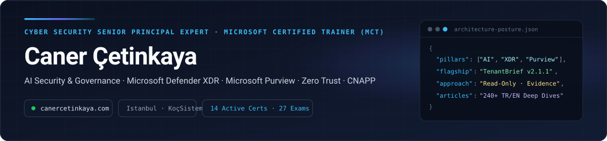

  <a href="https://canercetinkaya.com">
    <picture>
      <source media="(prefers-color-scheme: dark)" srcset="./assets/banner-dark.svg" />
      <source media="(prefers-color-scheme: light)" srcset="./assets/banner-light.svg" />
      
    </picture>
  </a>

  
  
  
  
  
  

---

### Hakkımda

Kurumsal ölçekte **Yapay Zekâ Güvenliği (AI Security)**, **Microsoft Defender XDR**, **Microsoft Purview**, **Zero Trust** ve **Çoklu Bulut Güvenliği (CNAPP/CSPM)** mimarileri tasarlayan bir **Cyber Security Senior Principal Expert** ve **Microsoft Certified Trainer (MCT)** olarak çalışıyorum.

Bu profilde; üretim ortamlarını değiştirmeden kanıta dayalı güvenlik duruşu analizi yapan **salt okunur denetim araçları**, **M365/Azure lisans ve uyumluluk otomasyonları** ile **KQL/PowerShell tespit mühendisliği** çalışmalarımı açık kaynak olarak paylaşıyorum.

---

### Uzmanlık Alanları

<table>
  <tr>
    <td width="33%" valign="top">
      <h4>Yapay Zekâ Güvenliği &amp; Yönetişimi</h4>
      <ul>
        <li>Enterprise AI Security Mimarisi</li>
        <li>Microsoft Copilot Veri Koruma &amp; Oversharing Önleme</li>
        <li>Shadow AI Yönetişimi (MDCA &amp; Browser DLP)</li>
        <li>DSPM for AI &amp; Prompt Injection Savunması</li>
      </ul>
    </td>
    <td width="33%" valign="top">
      <h4>Microsoft Güvenlik &amp; Veri Koruma</h4>
      <ul>
        <li>Microsoft Defender XDR (MDE, MDI, MDO, MDCA)</li>
        <li>Microsoft Sentinel &amp; KQL Tespit Mühendisliği</li>
        <li>Microsoft Entra ID &amp; Zero Trust Kimlik Mimarisi</li>
        <li>Microsoft Purview (DLP, IRM, MIP, eDiscovery)</li>
      </ul>
    </td>
    <td width="33%" valign="top">
      <h4>Bulut Güvenliği &amp; Otomasyon</h4>
      <ul>
        <li>Microsoft Defender for Cloud (CNAPP / CSPM)</li>
        <li>Azure, AWS &amp; GCP Çoklu Bulut Güvenliği</li>
        <li>PowerShell 7 Salt Okunur Denetim Modülleri</li>
        <li>CISA SCuBA, CIS M365 &amp; Zero Trust Eşlemeleri</li>
      </ul>
    </td>
  </tr>
</table>

---

### Öne Çıkan Açık Kaynak Projeler

| Proje | Odak Alanı | Öne Çıkan Mimari Yetenekler | Teknoloji |
| :--- | :--- | :--- | :--- |
| **[TenantBrief](https://github.com/canercetinkaya/TenantBrief)** | M365 & Azure Güvenlik Duruşu ve Lisans ROI | Salt okunur denetim, 6 ana güvenlik sütunu + 42 ortak kontrol eşlemesi (`ZeroTrustAssessment`, `ScubaGear 2.0`, `ORCA`, `EIDSCA`, `CIS v7.0.0`), 32 SKU lisans israfı analizi, sıfır pencereli X.509 sertifika kimlik doğrulaması ve çevrimdışı TR/EN HTML raporu. | `PowerShell 7` `Microsoft Graph` |
| **[CloudShield MSSP Portal](https://github.com/canercetinkaya/cloudshield-mssp-portal)** | Yönetilen Güvenlik Görünürlüğü & Raporlama | Microsoft güvenlik ve uyumluluk iş yükleri için aylık kurumsal raporlama, lisans istihbaratı ve yönetilen hizmet görünürlük platformu. | `Python 3.11` `Azure` |
| **[MDE Reporting](https://github.com/canercetinkaya/mde-reporting)** | Uç Nokta Güvenliği KPI Raporlaması | Kurumsal müşteriler için Microsoft Defender for Endpoint (MDE) operasyonel KPI ve güvenlik duruşu raporlama otomasyonu. | `Defender XDR` `Automation` |
| **[Restrict Sign-ins for PowerShell Modules](https://github.com/canercetinkaya/Restrict-sign-ins-for-PowerShell-modules-)** | Entra ID Erişim Sıkılaştırması | Microsoft Entra ID üzerinde PowerShell modüllerine yönelik oturum açma ve erişim kısıtlama yapılandırma şablonları. | `PowerShell` `Entra ID` |

---

### Son Teknik Makaleler (`canercetinkaya.com`)

> Her gün [`canercetinkaya.com/rss.xml`](https://canercetinkaya.com/rss.xml) üzerinden GitHub Actions ile otomatik güncellenir · [Tüm 240+ TR/EN Makaleyi Gör →](https://canercetinkaya.com/tr/blog/)

<!-- BLOG-POST-LIST:START -->
| Tarih | Makale |
| :--- | :--- |
| `24 Kas 2026` | [TenantBrief: Microsoft 365 Güvenlik Duruşunu ve Lisans İsrafını Tek Karar Yüzeyinde Buluşturmak](https://canercetinkaya.com/tr/blog/tenantbrief-m365-lisans-roi-uyumluluk-analizi/) |
| `23 Kas 2026` | [Azure Firewall Premium: Secure AI ve Secure with AI Eklentisinin Kurumsal Mimari Analizi](https://canercetinkaya.com/tr/blog/azure-firewall-premium-secure-ai-secure-with-ai-2026/) |
| `16 Kas 2026` | [Microsoft Entra Conditional Access Policy Plans (Preview) ile Politika Yığınını Yönetilebilir Mimariye Dönüştürmek](https://canercetinkaya.com/tr/blog/entra-conditional-access-policy-plans-preview/) |
| `14 Kas 2026` | [Microsoft Purview Referans Mimarisi [Bölüm 1/8]: Sınıflandırmadan Copilot Cowork'e Uçtan Uca Sebep-Sonuç Zinciri](https://canercetinkaya.com/tr/blog/microsoft-purview-referential-architecture-deep-dive/) |
| `14 Kas 2026` | [Microsoft Purview Referans Mimarisi [Bölüm 2/8]: Sınıflandırma Motorları (MCE vs. DCS), Etiket Öncelik Hiyerarşisi ve Unified Catalog Yapılandırması](https://canercetinkaya.com/tr/blog/purview-mimari-seri-02-siniflandirma-motorlari-etiketleme-unified-catalog/) |
| `14 Kas 2026` | [Microsoft Purview Referans Mimarisi [Bölüm 3/8]: SharePoint ve OneDrive DLP — 6 Senaryo, İlk Misafir Erişimi Penceresi, DLP Rule Undo ve Temmuz 2025 UDP](https://canercetinkaya.com/tr/blog/purview-mimari-seri-03-sharepoint-onedrive-dlp-guest-access-udp/) |
<!-- BLOG-POST-LIST:END -->

---

### Doğrulanmış Sertifikalar & Yetkinlikler

- **Microsoft Certified Trainer (MCT)** — 2017'den beri kesintisiz
- **14 Aktif Microsoft Sertifikası · 27 Geçilen Sınav · 4 Applied Skills**
  - `Azure Solutions Architect Expert` · `Microsoft 365 Enterprise Administrator Expert` · `DevOps Engineer Expert`
  - `Azure Security Engineer Associate` · `Security Operations Analyst Associate` · `Identity and Access Administrator Associate` · `Information Protection Administrator Associate`
- **Yapay Zekâ & Çoklu Bulut:** `Frontier Executive – Titan` (Microsoft) · `Gen AI: Beyond the Chatbot` (Google Cloud)

<strong>Kullandığım Temel Araç ve Teknolojiler</strong>

 

- **Güvenlik & Yönetişim:** Microsoft Defender XDR, Microsoft Sentinel, Microsoft Purview, Microsoft Entra ID, Microsoft Intune, Defender for Cloud, Azure Firewall Premium
- **Denetim & Çerçeveler:** Zero Trust Architecture, CISA SCuBA, CIS Microsoft 365 Foundations, MITRE ATT&CK, NIST CSF, Microsoft Well-Architected
- **Geliştirme & Otomasyon:** PowerShell 7, KQL (Kusto Query Language), Python, TypeScript / Next.js, GitHub Actions, Bicep / Terraform

---

  Kurumsal siber güvenlik mimarisi, teknik iş birlikleri veya açık kaynak projeler hakkında iletişime geçmek için <a href="https://www.linkedin.com/in/canercetinkaya/">LinkedIn</a> veya <a href="https://canercetinkaya.com/tr/about/">canercetinkaya.com</a> üzerinden ulaşabilirsiniz.

